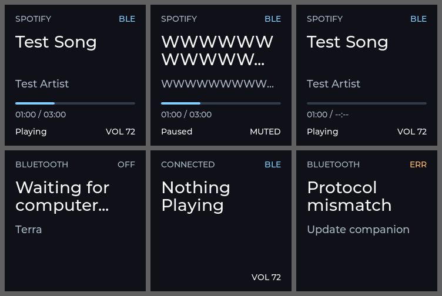

# Terra — Desktop Music Preview & Controller

**Terra** adalah perangkat meja ESP32-S3 N16R8 dengan layar ST7789 240×240, didampingi aplikasi
Windows. Spesifikasi lengkap: [PROJECT_SPEC.md](PROJECT_SPEC.md).

## Status per fase (12 Oktober 2026)

| Fase | Isi | Status |
| --- | --- | --- |
| M0 | Monorepo, docs, build firmware + Rust | Lulus, CI GitHub hijau |
| M1 | ST7789 240×240 + LVGL | Diuji di hardware: tampil, warna normal, tidak terpotong |
| M2 | 3 tombol + encoder half-step, debounce, queue | Diuji di hardware; sisa uji ketahanan di [validasi](docs/validation.md) |
| N0 | Probe sektor USB HDD read-only | Build lulus; uji fisik menunggu USB-A + cabang daya |
| M3 | BLE GATT `Terra`: RX/TX/STATUS | Diuji dari laptop: discover, connect, service, write RX, subscribe TX |
| M4 | Protokol V1: fragmentasi, reassembly, HELLO, MEDIA/VOLUME_STATE | 57 vector bersama C/Rust/Python; uji BLE hardware lulus; konfirmasi visual layar menunggu |
| M5 | `terra-cli media` / `media --watch` membaca sesi media Windows (GSMTC) | Diuji di laptop: metadata, status, timeline, pause/track/seek |
| M6 | `terra-cli devices` / `connect`: companion Rust mengirim media Windows ke Terra lewat BLE | Diuji: scan, connect, handshake, play/pause/ganti lagu/seek diterima perangkat |
| M7 | Previous / Play-Pause / Next fisik → sesi Windows aktif | Diuji di hardware tanpa diagnostik (Chrome): Play/Pause 8/8, Previous 4/4, Next 4/4, satu command per tekanan. Kasus tepi di [uji M7](docs/m7-test.md) belum diulang |
| M8 | Encoder volume/mute ↔ master volume Windows (Core Audio) | Diuji di hardware: 12/12 klik encoder dan 4/4 mute sampai Windows dan kembali ke perangkat; perubahan dari Windows sampai ke perangkat. Menunggu konfirmasi visual LCD dan ganti perangkat output; lihat [uji M8](docs/m8-test.md) |
| M9 | Reconnect otomatis dengan backoff, pemulihan BLE, perpindahan aplikasi media | Diuji di hardware: Bluetooth off/on, ESP restart, sleep/wake, Chrome ↔ Spotify, companion mati/dijalankan ulang; pulih tanpa restart. Lihat [validasi](docs/validation.md) |
| M10 | GUI Tauri, tray, autostart | Belum dimulai |

Wire format: [ble-protocol.md](docs/ble-protocol.md). Pemakaian sekarang: putar musik di
Windows, lalu jalankan `companion\target\debug\terra-cli.exe connect` (atau `monitor`).
Firmware **0.4.0** mengirim tombol Previous, Play/Pause, Next serta encoder volume (±2)
dan mute ketika link READY; companion menjalankannya di Windows dan mengirim balik
volume aktual (`terra-cli volume` membaca volume saja). `connect` terus berjalan dan
menyambung ulang sendiri setelah koneksi putus (M9).

Layar dari renderer LVGL yang sama, dijalankan di komputer (bukan foto hardware):



## Build

Dengan toolchain lokal checkout ini, dari root:

```powershell
.\scripts\test-host.ps1
.\scripts\build-firmware.ps1 -Profile normal
.\scripts\build-firmware.ps1 -Profile usb-probe
```

Profil USB memerlukan console **COM/UART**, suplai HDD terverifikasi, dan data
pada port **USB native**. Lihat panduan M2/N0 sebelum flash. Build tidak melakukan flash.

Aktifkan ESP-IDF **6.0.3** lalu:

```powershell
cd firmware
idf.py set-target esp32s3
idf.py build
```

Dengan Rust stable dan linker Windows yang sesuai:

```powershell
cd companion
cargo build --workspace --locked
cargo test --workspace --locked
cargo run -p companion-cli -- --version
```

Untuk toolchain lokal yang disiapkan dalam sesi ini, dari root proyek:

```powershell
. .\scripts\activate-local.ps1
```

Lihat [panduan development](docs/development.md) untuk setup pada komputer lain,
pengujian, dan flash. Jangan flash sebelum memeriksa [wiring](docs/wiring.md).

## Dokumen

- [Arsitektur dan batas milestone](docs/architecture.md)
- [Wiring dan asumsi panel](docs/hardware.md)
- [Detail wiring perakitan & daftar kabel](docs/wiring.md)
- [Protokol BLE V1 (kanonik)](docs/ble-protocol.md)
- [State machine](docs/state-machine.md)
- [Build dan pengujian hardware](docs/development.md)
- [Laporan validasi](docs/validation.md)
- [Uji tombol M7](docs/m7-test.md)
- [Uji volume M8](docs/m8-test.md)
- [Uji keandalan M9](docs/m9-test.md)
- [Changelog](CHANGELOG.md)
- [Proposal NAS dan Vercel](docs/nas-proposal.md)
- [Uji input M2 dan diagnostik disk N0](docs/m2-n0-test.md)
- [Web console](web-console/README.md)

Status "diuji di hardware" hanya ditulis setelah ada keluaran perangkat nyata;
build firmware saja tidak membuktikan orientasi, warna, wiring, maupun radio.
