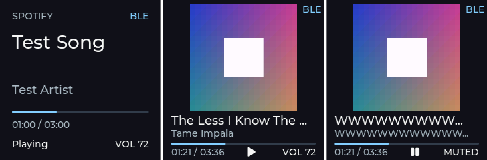

# Penerimaan V2 — album artwork

Firmware **0.5.0** dan companion dari source V2 (CLI atau aplikasi). Wire format
dan perilaku penerima: [ble-protocol.md §4.8](ble-protocol.md). Arah V2 di
spesifikasi proyek §36: thumbnail Windows → decode → resize 160×160 → JPEG →
transfer → ESP32 → PSRAM → gambar LVGL.

Gambar di atas berasal dari `ui.c` yang sama yang dirender di komputer (cover
pengganti berupa gradien), bukan foto panel.

## Persiapan

1. `scripts/test-host.ps1`, `cargo test --workspace --locked`, build kedua profil.
2. Flash `usb-probe` ke COM11 (lihat [m7-test.md](m7-test.md)) atau `normal`.
3. Putar lagu yang punya cover (Spotify, YouTube Music di Chrome).
4. Opsional, tanpa perangkat: `companion\target\debug\terra-cli.exe artwork cover.jpg`
   menyimpan JPEG persis seperti yang akan dikirim (160×160, ±4–10 KB).
5. Jalankan `terra-cli monitor` (atau aplikasi). Log harus memuat
   `HELLO protocol=1 firmware=0.5.0` dan `[PROTOCOL] device shows album artwork`.

## Pemeriksaan

| Aksi | Hasil yang diharapkan |
| --- | --- |
| Lagu dengan cover diputar | Dalam ±1–2 s: `[ARTWORK] sent N bytes in X s`; UART `Artwork … shown`; LCD menampilkan cover di atas judul/artis/progres |
| Warna dan orientasi cover | Sama dengan cover di aplikasi/jendela media Windows (tidak terbalik, tidak tertukar merah/biru) |
| Next/Previous | Cover lama hilang saat judul berganti, cover baru muncul tanpa sisa gambar lama |
| Tekan tombol/encoder saat cover sedang dikirim | Perintah tetap dijalankan segera (chunk mengalah ke event) |
| Lagu/aplikasi tanpa thumbnail | Tata letak teks seperti M4–M9 |
| Video YouTube 16:9 | Cover persegi dari bagian tengah thumbnail |
| Pause/Play di lagu yang sama | Cover tetap, tidak dikirim ulang |
| Putus BLE / reset ESP | Setelah tersambung lagi, cover dikirim ulang otomatis |
| Companion lama (M10) + firmware 0.5.0 | Tetap tersambung; tanpa cover |
| Companion V2 + firmware 0.4.0 | Tidak ada pesan artwork; perilaku M10 |

## Hasil yang perlu dilaporkan

Log companion dan UART, foto LCD dengan cover, catatan kecocokan warna, serta
lagu/aplikasi yang tidak menampilkan cover padahal Windows menampilkannya.

## Cakupan otomatis

- 79 vector bersama Python/C/Rust, termasuk BEGIN/CHUNK/END, batas ukuran, CRC.
- C: penerima artwork (urutan, celah, id asing, overflow, CRC, restart) dan
  transport produksi (sukses, CRC rusak, JPEG tak ter-decode, clear, ganti lagu
  di tengah transfer, belum READY). Decoder JPEG ROM hanya berjalan di perangkat.
- Rust: crop persegi, chunk mengalah ke event BLE, artwork mengikuti lagu yang
  tampil, tidak dikirim ke firmware tanpa bit3.
- Renderer host: tata letak artwork (judul/artis panjang, muted, pause) di dalam layar.
