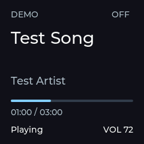
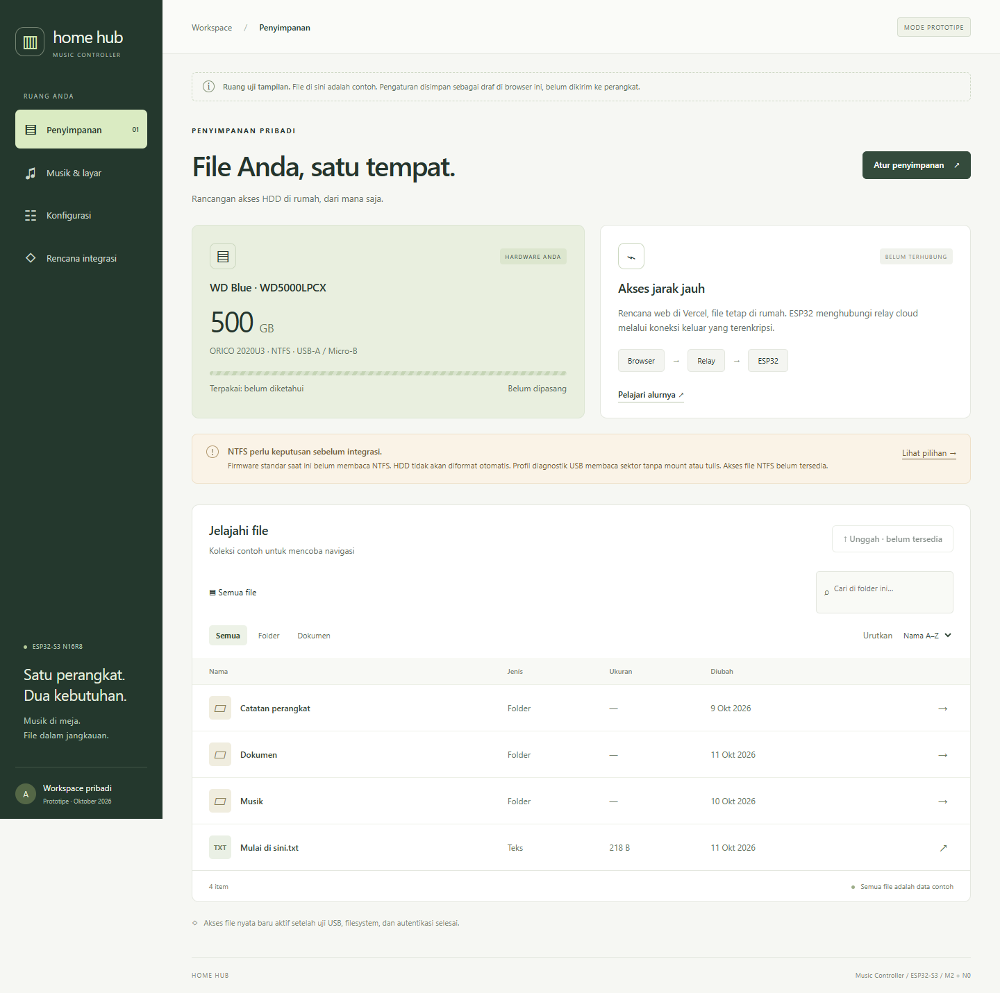

# Laporan validasi

## Pemeriksaan ulang M7 dan implementasi M8 — 12 Oktober 2026

**Pemeriksaan ulang M7 (software):** sebelum perubahan M8, `scripts/test-host.ps1`
lulus (time, input, disk, 57 vector, transport produksi), `cargo test --workspace
--locked` lulus, dan firmware 0.3.0 profil normal berhasil dibangun. Review kode
routing tombol, antrean sesi/umur 500 ms, dan dispatch GSMTC tidak menemukan cacat
baru. Status hardware M7 tetap **penerimaan parsial** seperti di bawah.

**M8 — compile verified dan software tested:**

- Firmware 0.4.0: kedua profil lulus dengan `-Werror`; image normal 879.441 byte,
  USB probe 945.809 byte. Build USB lokal memakai `CONFIG_TERRA_INPUT_DIAGNOSTICS`
  mati agar uji berikutnya juga menjadi uji tombol M7 tanpa diagnostik.
- Host C: transport produksi meneruskan VOLUME_DELTA ±2 dan MUTE_TOGGLE; perintah
  tidak sah (delta 0/101, mute bernilai, SEEK_DELTA, ID 7) ditolak.
- Rust: 15 tes lulus, termasuk pembulatan skalar, clamp, routing encoder sekali,
  dan urutan BLE di tengah burst event media+volume. Build tanpa warning.
- **Core Audio nyata di laptop pengembangan** (bukan perangkat Terra):
  `terra-cli volume` membaca 14%, tidak mute. Tes `--ignored` menaikkan ke 16%,
  kembali 14%, mute lalu unmute, dan menerima 4 notifikasi perubahan; nilai akhir
  sama dengan awal.

**Hardware tested (sebagian, Windows → perangkat):** firmware USB probe 0.4.0
di-flash ke COM11 (hash ketiga image diverifikasi). Companion M8: connect,
`HELLO protocol=1 firmware=0.4.0`, link Ready, `rx_errors 0`, media Chrome, dan
`[VOLUME] 14`. Tombol volume keyboard Windows (naik, turun, mute, unmute, jeda
1,5 detik) menghasilkan `[VOLUME] 16`, `14`, `14 muted`, `14` di companion dan
`STATE: Volume 16`, `14`, `14 (muted)`, `14` di UART. Volume akhir dikembalikan
ke 14%. Perubahan dalam satu jendela 50 ms yang kembali ke nilai semula tidak
dikirim (sesuai rancangan: hanya keadaan akhir). Log: `.tools/m8-companion.log`,
`.tools/m8-uart.log`, `.tools/m8-flash.log`.

**Uji pengguna encoder dan tombol (firmware 0.4.0, diagnostik GPIO mati, Chrome/
YouTube Music):**

- Encoder: 12 klik (5 naik, 5 turun, 1 naik, 1 turun) → 12 `MEDIA_COMMAND 4 ±2`
  firmware → 12 `VolumeDelta` companion → 12 `STATE: Volume`; urutan 14→24→14→16→14.
  Tidak ada command hilang, dobel, `ESP_ERR_TIMEOUT`, atau ERROR. Dari log UART,
  tekanan sampai VOLUME_STATE diterima 85–165 ms.
- Tombol encoder: 4 tekanan → 4 `MEDIA_COMMAND 5 0` → muted/unmuted bergantian.
- Windows → perangkat: perubahan di luar encoder (16/14 lalu 12/10/8/10) sampai
  ke firmware.
- **M7 tanpa diagnostik:** Play/Pause 8/8 Accepted dengan playback bergantian;
  Previous 4/4 (pertama kembali ke 0,1 s, tiga berikutnya pindah lagu); Next 4/4
  pindah lagu. Setiap tekanan menghasilkan tepat satu `MEDIA_COMMAND`. Kriteria
  inti M7 (tombol fisik mengendalikan sesi media Windows aktif) **terpenuhi**;
  baris tepi m7-test (tanpa sesi, aplikasi tidak mendukung, ganti aplikasi,
  tekan saat BLE putus) belum diuji ulang.
- **Temuan:** setiap ganti lagu di Chrome, GSMTC sesaat melaporkan tidak ada sesi
  aktif; companion mengirim NO_MEDIA dan LCD menampilkan "Nothing Playing"
  0,2–3,5 detik sebelum lagu baru. Perilaku Windows/Chrome ini dicatat dulu
  (aturan 15); penanganannya direncanakan bersama perpindahan aplikasi media di M9.

Status M8: kriteria encoder → volume Windows dan Windows → perangkat terbukti di
log. Konfirmasi visual `VOL NN`/`MUTED` di LCD dan pergantian perangkat output
default masih menunggu laporan pengguna. Log: `.tools/m8-companion.log`,
`.tools/m8-uart.log`.

## Tindak lanjut uji pengguna M7 — 12 Oktober 2026

Pengguna menguji YouTube di Chrome: judul sudah tampil dan mengikuti video di
LCD (konfirmasi visual M6). M7 **belum lulus**: dilaporkan hanya klik pertama
masing-masing tombol bekerja. Companion mencatat empat command awal Accepted,
tanpa error, dan tetap menerima perubahan media.

Pada uji ulang Play/Pause empat tekanan dengan jeda sekitar dua detik, rekaman
UART hanya mendapat satu `INPUT: MEDIA_COMMAND 1: ESP_OK`, lalu companion
Accepted dan status Paused. Kehilangan terjadi sebelum pengiriman BLE;
penyebab debounce/kontak belum dipastikan. Diagnostik GPIO tekan/lepas sedang
disiapkan. Jangan menyatakan M7 diterima sampai uji ulang berulang berhasil.

**Uji ulang dengan diagnostik aktif:** build profil USB lulus, image 946.225 byte
(bin dipadding menjadi 946.336 byte), flash COM11 diverifikasi. Tidak ada perubahan
algoritme debounce (tetap 40 ms) atau routing command; hanya pencatatan edge GPIO
melalui `CONFIG_TERRA_INPUT_DIAGNOSTICS=y` pada konfigurasi lokal.

- Windows berpindah dari Spotify ke Apple Music dan companion mengikuti sesi aktif.
- Empat tekanan Play/Pause di Apple Music: empat LOW/HIGH GPIO5, empat
  `MEDIA_COMMAND 1: ESP_OK`, empat hasil Accepted, playback bergantian Paused/Playing.
  Pantulan saat pelepasan terakhir (HIGH 1 ms, LOW 1 ms) tidak menambah command.
- Empat klik biasa berikutnya (durasi LOW 140, 158, 99, 129 ms) juga menghasilkan
  empat command dan perubahan playback; pengguna mengonfirmasi “sudah bisa”.
  Meski instruksi uji menyebut Chrome, log companion pada rangkaian ini masih
  menunjukkan **Apple Music**; jangan mencatatnya sebagai uji Chrome terverifikasi.
- Sumber kegagalan awal **belum terbukti**. Flash/reset dan logging diagnostik
  terjadi sebelum uji ulang; hasil ini belum membuktikan perbaikan permanen.
  Next/Previous berulang dan pengulangan tanpa logging masih perlu diperiksa.

**Rangkaian Next/Previous berikutnya:** log Apple Music mencatat Next 3/3
Accepted dengan tiga judul baru. Previous menghasilkan tiga command dari GPIO4,
tetapi companion mencatat Unsupported karena `IsPreviousEnabled=false` dan
belum memanggil `TrySkipPreviousAsync`. Pengguna kemudian mengonfirmasi bahwa
Previous memang masih bermasalah. Ada pulsa LOW 1 ms di antara tekanan normal
125–165 ms; debounce tidak meneruskannya sebagai command.

Companion diubah untuk tetap mencoba satu `Try*Async` atas tekanan yang valid;
hasil API menentukan Accepted, sedangkan false dibedakan Rejected/Unsupported
berdasarkan capability snapshot. Tidak ada fallback keyboard global atau seek
diam-diam. Build dan 12 tes Rust lulus setelah perubahan.

**Uji ulang YouTube Music di Chrome:** pengguna menekan Previous empat kali dan
melaporkan tekanan kedua serta keempat tampak tidak bekerja. UART mencatat empat
tekanan GPIO4 (LOW 143, 113, 107, 98 ms), masing-masing menghasilkan tepat satu
`MEDIA_COMMAND 3: ESP_OK`. Companion mencatat empat `Previous: Accepted`; dua
pembaruan posisi menunjukkan lagu yang sama kembali ke sekitar 0,1 detik.
Tidak ada kehilangan command yang terlihat pada rangkaian ini.

Pada pembandingan di antrean yang sama, pengguna mengonfirmasi **tombol Previous
di halaman web juga tidak selalu bereaksi**. Ini menunjukkan gejala juga terjadi
tanpa tombol Terra; belum membuktikan penyebab spesifik di YouTube Music, antrean,
atau Chrome. `Accepted` tidak menjamin perpindahan lagu. Jangan menambahkan retry
otomatis atau mengubah debounce berdasarkan hasil ini karena satu tekanan bisa
memicu dua aksi. Log: `.tools/m7-previous-api.log`.

Status M7 tetap **penerimaan parsial**: Play/Pause Apple Music 8/8 dan Next 3/3
terverifikasi; Previous Chrome 4/4 sampai API Windows, efek mengikuti keterbatasan
yang juga terlihat pada tombol web. Previous Apple Music setelah perubahan API
serta pengulangan input tanpa logging diagnostik belum diverifikasi. Penyebab
kehilangan input awal tetap terbuka dan berbeda dari gejala Previous terbaru.

Log lokal: `.tools/m7-input-diagnostic-uart.log` dan
`.tools/m7-input-diagnostic-companion.log`. Diagnostik default mati di source,
tetapi aktif pada firmware USB yang sedang dipasang untuk pengujian ini.

## Audit M0–M6 dan pengembangan M7 — 12 Oktober 2026

Checkout diperiksa dari commit dasar `779872e` (M6), kini berlokasi di
`D:\Personal\Project\terra-pocket`. Wiring/calibration M1–M2 yang sudah diukur
dipertahankan. Alur sesuai blueprint: GSMTC → Rust companion → BLE V1 →
app_state → LCD 240×240; M7 menambahkan arah tombol → GSMTC.

### Temuan dan perbaikan

- **Prioritas tinggi:** penggabungan event GSMTC menguras seluruh antrean dan
  membuang notifikasi BLE selain disconnect. Diperbaiki dengan deadline 150 ms
  yang hanya menggabungkan sinyal media; test memasukkan command dan ERROR di
  tengah burst media serta memastikan urutan tetap utuh.
- **Prioritas sedang:** HELLO ulang sebelumnya dijawab memakai ACK lama tanpa
  memvalidasi versi/payload. Sekarang divalidasi ulang. Deadline handshake juga
  menghentikan perangkat yang terus mengirim paket selain HELLO.
- **Prioritas sedang:** jalur gagal saat registrasi parsial dapat meninggalkan
  event handler/koneksi yang dipertahankan. Handler media dan koneksi BLE kini
  dibersihkan pada jalur gagal. Audit source dan compile; kegagalan WinRT tersebut
  belum diinjeksi pada perangkat nyata.
- **Prioritas sedang:** firmware belum mereset reassembler saat unsubscribe dan
  menerima HELLO_ACK sebelum subscribe. Keduanya dikoreksi serta diuji host.
- Scan default kini menyelesaikan interval sebelum memilih RSSI terkuat; sebelumnya
  berhenti pada perangkat pertama meski help menyebut terkuat. Timeline memakai
  pengurangan jenuh agar nilai ekstrem aplikasi tidak menyebabkan overflow.
- Dokumen arsitektur/development yang masih menggambarkan scaffold M1 diperbarui.

### Bukti software dan radio

- Baseline dan hasil akhir `scripts/test-host.ps1` lulus: time, input, disk,
  57 vector protokol, ditambah harness transport produksi untuk M7. Harness
  menguji handshake, tiga tombol, offline, kedaluwarsa, pergantian sesi,
  re-subscribe, duplicate ACK, dan antrean penuh; radio/scheduler di-stub.
- `cargo test --workspace --locked`: 12 tes lulus (termasuk dua tes regresi M7),
  `cargo build --workspace --locked` lulus dengan toolchain GNU lokal.
- 57 vector hasil generator Python identik dengan vector di repo.
- Kedua profil firmware 0.3.0 berhasil dibangun dengan `-Werror`; ukuran image
  normal 879.585 byte dan USB probe 945.925 byte (bin dapat dipadding).
- COM11 teridentifikasi sebagai CH343 `1A86:55D3`; firmware USB probe 0.3.0
  di-flash dan hash diverifikasi. BLE MAC `28:84:85:48:15:BA`, MTU 247.
- Harness BLE nyata lulus pada firmware lama 0.2.0 **dan** 0.3.0: discovery,
  HELLO/ACK, READY, media/volume, pesan malformed/versi asing/orphan,
  reassembly media 361 byte, lalu disconnect. M7 mengiklankan caps `0x0007`.
  Log lokal: `.tools/m6-regression-ble.log`, `.tools/m7-regression-ble.log`.
- Companion M7 nyata berhasil connect/HELLO/READY pada board dan membaca
  keadaan Windows tanpa media; log `.tools/m7-companion.log` dan UART
  `.tools/m7-uart.log`. Hasil tombol fisik dicatat setelah konfirmasi pengguna.

### Batas penerimaan

M0–M6 berada pada jalur blueprint, tetapi **belum boleh disebut seluruh acceptance
selesai**: konfirmasi visual metadata nyata, ketahanan input, aplikasi nyata,
serta sleep/wake/koneksi lama masih mengikuti daftar uji. M7 membutuhkan
[penerimaan tombol fisik](m7-test.md). Build/test tidak menggantikan uji tersebut.
M8 volume, M9 reconnect, M10 GUI, dan NAS NTFS/cloud belum diimplementasikan.
Tidak ada operasi tulis/format HDD dalam pekerjaan ini. CI diperbarui; belum
ada klaim run GitHub untuk perubahan yang belum di-push.

## M6 — 12 Oktober 2026

**Software tested:** `cargo test --workspace` lulus (aturan sinkronisasi, pemotongan
UTF-8, parsing alamat, UUID). **Hardware tested** (laptop pengguna ↔ board di meja):
`terra-cli devices` menemukan `28:84:85:48:15:BA` RSSI −33 dBm. `terra-cli connect`:
connect, paket 244 byte, HELLO protocol 1 firmware 0.2.0, status READY. Dengan sesi
media uji (audio senyap di browser pane, source `Claude`), companion mengirim tepat
enam MEDIA_STATE: nothing playing, playing 81,4 s, paused, playing, ganti lagu, seek
150,2 s; tidak ada pengiriman posisi berkala. Log perangkat: `Track changed` untuk
kedua lagu, tanpa paket ditolak; disconnect bersih saat companion dihentikan.

**Percobaan gagal yang dicatat:** discovery *uncached* sebelum link aktif → GATT
Unreachable, lalu HRESULT 0x80070016; menunggu sesi aktif sebelum discovery tidak
pernah selesai. Diperbaiki dengan urutan discovery-lalu-tunggu-sesi seperti bleak.

**Belum diverifikasi:** konfirmasi visual layar oleh pengguna, Spotify/YouTube nyata,
koneksi lama (> 1 menit), Bluetooth laptop off/on, sleep/wake (M9).

## M5 — 12 Oktober 2026

**Software tested:** `cargo test --workspace` lulus (estimasi posisi, nama source,
vector protokol). **Tested on the user's laptop** (Windows 11 26100): sesi media
dibuat oleh audio senyap dengan MediaSession metadata di browser pane aplikasi
Claude, bukan Spotify. `terra-cli media` mencetak Source `Claude`, judul, artis,
album, `Playing`, posisi yang maju (87,3 s lalu 90,4 s setelah 3 detik) dan durasi
216 s. `media --watch` mencatat Paused, Playing, pergantian lagu, dan seek ke 150 s
melalui event GSMTC tanpa polling. Tanpa sesi aktif: "No active media session".

**Belum diverifikasi:** Spotify desktop, YouTube/YouTube Music di Chrome/Edge,
aplikasi yang tidak memperbarui `LastUpdatedTime`, dan beberapa sesi bersamaan.

## M3/M4 — 12 Oktober 2026

**Compile verified:** build `normal` 878.821 byte dan `usb-probe` 945.197 byte, ESP-IDF
6.0.3, tanpa warning (`-Werror`). Partisi aplikasi 3 MiB.

**Software tested:** `scripts/test-host.ps1` lulus termasuk 57 vector protokol C;
`cargo test -p protocol` lulus pada vector yang sama; uji mutasi (satu byte vector
diubah) membuat tes C gagal sesuai harapan. Renderer host: enam layar (playing,
long-text, zero-duration, waiting, no-media, mismatch) dalam batas panel.

**Hardware tested** (board pengguna di COM11, Bluetooth laptop Intel, harness
`scripts/ble-test.py`, bleak 1.1.1):

- Advertising `Terra` dengan UUID service terlihat, RSSI −32 dBm di meja.
- Connect, MTU 247, service + RX/TX/STATUS dengan properti benar.
- STATUS CONNECTED sebelum handshake; subscribe TX → HELLO (protocol 1, firmware
  0.2.0, caps 0x0003); HELLO_ACK → READY.
- Tulis RX VOLUME_STATE + MEDIA_STATE diterima tanpa ERROR. MEDIA_STATE maksimum
  361 byte direassembly dari 2 paket (MTU 247) dan 23 paket (`--mtu 23`).
- Title 128 byte → ERROR MALFORMED; versi 2 → UNSUPPORTED_VERSION; fragmen tanpa
  START dibuang; MEDIA_COMMAND dari PC → UNSUPPORTED_TYPE. Perangkat tetap READY,
  `rx_errors` naik 4 per putaran, tidak ada reboot.
- Empat sesi connect/disconnect berturut-turut; setelah disconnect advertising lagi.
- Log UART build `usb-probe` cocok dengan development.md, termasuk metadata UTF-8
  multibyte dan emoji.

**Belum diverifikasi:** tampilan layar selama uji (menunggu konfirmasi visual
pengguna), log USB native build `normal`, nRF Connect/ponsel, jarak/interferensi,
dan durasi koneksi panjang. Companion Windows (M5/M6) belum ada; harness hanya
alat uji.

## Uji hardware pertama 11 Oktober 2026 — M1/M2 di perangkat

Board terdeteksi di COM11 (bridge CH343 `1A86:55D3`). esptool: ESP32-S3 (QFN56)
rev v0.2, PSRAM tertanam 8 MB, flash 16 MB quad. Uji memakai build `usb-probe`
(console UART) karena kabel pada port COM; kode LCD dan input sama dengan build
`normal`. USB-A/HDD tidak terpasang, jadi probe hanya menunggu.

- **Bug ditemukan:** stack overflow di task `main` saat render pertama LVGL
  (`lv_refr_now` di `display_render`), boot loop. Stack main 3.584 → 8.192 byte;
  sisa terukur 4.432–4.464 byte. Log sisa stack ditambahkan.
- Wiring awal salah dan dikoreksi pengguna dengan bantuan pemindai pin: tombol
  tersambung GND permanen, lalu GND tombol mengambang, dan encoder di GPIO8/9/10.
- Encoder terukur half-step (10 transisi untuk 5 klik); decoder half-step
  ditambahkan beserta tes host dari urutan yang terekam.
- **LCD:** setelah rewiring, layar menampilkan fixture DEMO (Test Song) dengan
  modul 7 pin tanpa CS, SPI mode 3, gap 0/0. Pengguna melaporkan warna normal dan
  tidak ada tepi terpotong; inversi warna dan offset (0,0) cocok untuk modul ini.
- **Input:** Previous 3/3, Play/Pause 3/3, Next 3/3, CW 5 klik → `VOLUME +2` ×5,
  knob 3/3 `MUTE`, tahan Play 3 detik → satu event tanpa repeat. CCW 5 klik →
  `VOLUME -2` ×6: event ke-6 berjarak 60 ms dari ke-5, kemungkinan knob melewati
  detent saat dilepas; perlu diulang sebelum M2 diterima.
- Belum diuji: build `normal` lewat USB native, 20× per tombol, putaran cepat,
  dua tombol bersamaan, boot sambil menahan tombol, N0 dengan HDD.

## Fase lanjutan 11 Oktober 2026 — M2 / N0

- Firmware normal M2: `idf.py -C firmware build size` lulus, exit 0;
  binary 579.472 byte, log `.tools/m2-build.log`. LCD tetap 240×240,
  USB probe default nonaktif.
- Firmware profil USB: `scripts/build-firmware.ps1 -Profile usb-probe` lulus,
  exit 0, binary 644.720 byte; log `.tools/n0-build.log`. Konfigurasi hasil build
  menunjukkan MUSIC_USB_PROBE=y, console UART0 aktif, USB Serial/JTAG utama dan
  sekunder nonaktif. Kedua profil tidak menghasilkan compiler warning/error.
  Ada catatan Kconfig vendor FATFS_PRINT_FLOAT/default bool; tidak menghalangi
  build dan tidak diatasi dengan mengubah kode vendor.
- Tes C host: pemformat waktu, debounce/encoder, parser metadata disk lulus
  melalui `scripts/test-host.ps1`, memakai `-Wall -Wextra -Werror`.
  Meliputi bounce, held-at-boot, release, rollover timer, reversal/invalid encoder,
  NTFS signature, MBR/GPT marker, input pendek/null, dan overflow/rentang sektor.
- Web: lima tes model lulus; skenario browser desktop/mobile lama tetap lulus,
  plus penyimpanan pilihan Cloudflare Free setelah reload. Empat halaman tidak
  overflow horizontal pada 375 px. Screenshot proposal 1440/375 px diperiksa.
- Dashboard M2/N0 berhasil dipublikasikan privat pada URL yang sama; native
  deployment berstatus `succeeded`, source commit Site
  `e52a9c0b87b0f49bd11bd7f47e09f8d3c49096e9`. Tidak ada deployment Vercel/relay.
- Tidak ada flash, mount, atau akses ke HDD fisik selama pengembangan. Input queue,
  timing GPIO, daya HDD, deteksi USB, cabut-pasang dan NTFS hardware belum diuji.
- N0 tidak menyediakan mount/list/download file. Probe membaca maksimal lima
  sektor; deteksi signature tidak setara implementasi driver NTFS. GPT/EBR belum
  ditelusuri. Cloudflare relay, Wi-Fi dan BLE belum diimplementasikan.
- Rust tidak diubah atau diuji ulang pada fase ini. CI diperbarui untuk dua profil
  firmware dan tes C, belum dijalankan di GitHub.

Instruksi dan log yang harus diverifikasi pada perangkat: [m2-n0-test.md](m2-n0-test.md).

## Riwayat 11 Oktober 2026 — LCD dan prototipe web sebelum M2

- Build firmware `idf.py -C firmware build size`: lulus, exit 0. Binary
  `music_controller.bin` 568.048 byte; log lokal `.tools/lcd240-build.log`.
- Render host LVGL 240×240: normal, teks panjang, dan durasi nol lulus.
  Harness memeriksa batas framebuffer dan semua widget; normal/teks panjang
  diperiksa secara visual. Resolusi harness mengikuti `board_config.h`.
- Web: empat tes model lulus (validasi konfigurasi, batas UTF-8, filter/sort,
  konsistensi fixture). Pemeriksaan sintaks JavaScript lulus.
- Uji browser Edge melalui Playwright: desktop 1440 px dan ponsel 375 px,
  empat halaman tanpa overflow horizontal; folder, pencarian, filter, unduh teks,
  simpan/reload/reset dan ekspor JSON lulus. Tidak ada page error.
- Screenshot desktop dan ponsel diperiksa. Seluruh file web adalah contoh;
  konfigurasi tersimpan hanya sebagai draf browser, belum dikirim ke ESP32.
- Preview privat berhasil dipublikasikan melalui Sites:
  https://music-controller-hub-ammar.sappyquail1.chatgpt.site
  Status deployment `succeeded`; ini bukan deployment Vercel atau backend NAS.
  Source publikasi identik dengan `web-console/`, disinkronkan dari checkout
  terpisah `.tools/site-publish` agar tidak membuat repository Git bersarang.
- NAS, NTFS, USB Host, suplai HDD, relay, dan akses remote belum diimplementasikan
  atau diuji. Tidak ada flash, mount, format, maupun penulisan HDD.
- Rust tidak diubah atau diuji ulang pada pembaruan ini. M2 belum dimulai.





Controller ST7789 dan resolusi 240×240 sudah dikonfirmasi pengguna. Model breakout
dan board fisik masih perlu diverifikasi. Gap awal sekarang (0,0); beberapa panel
memerlukan offset lain (misalnya 80) sesuai orientasi. Render host tidak menguji
warna, backlight, PSRAM, wiring, atau offset panel fisik.

## Riwayat M0/M1 — 15 September 2026

Tanggal: 15 September 2026. Scope mengikuti PROJECT_SPEC bagian 38: berhenti
setelah fondasi dan display bring-up. M2 tidak dimulai.

## Berkas yang dibuat

| Kelompok | Berkas / fungsi |
| --- | --- |
| Root | README, PROJECT_SPEC (salinan blueprint), CHANGELOG, gitignore/gitattributes |
| docs | architecture, hardware, ble-protocol, state-machine, development, validation |
| Firmware build | CMakeLists, sdkconfig.defaults, partitions.csv, dependencies.lock |
| Firmware main | CMakeLists, idf_component.yml, app_main, board_config, app_state |
| Display | display.c/h untuk SPI/panel/port; ui.c/h untuk widget |
| Utilities/tests | time_utils.c/h, test_time_utils.c, harness headless LVGL tests/preview |
| Companion | Cargo.toml/lock, manifest dan source enam crate, README GUI terencana |
| Tooling | scripts/activate-local.ps1, .github/workflows/build.yml |
| Vectors | README penanda lokasi fixture bersama M4, tanpa fixture palsu |

## Keputusan

- `app_main` hanya startup; state kanonik memiliki mutex dan API snapshot.
- LVGL hanya disentuh modul UI dengan lock port. Tidak ada callback BLE.
- Dua buffer DMA internal RGB565, masing-masing 19.200 byte; PSRAM diaktifkan
  dan diuji oleh boot IDF, belum digunakan untuk artwork/framebuffer.
- Fixture M1 statis dan diberi label DEMO/OFF; tidak mengklaim terhubung ke PC.
- Rust crate tahap mendatang hanya mendokumentasikan batas tanggung jawab.
- Tidak menambahkan dependency Windows/Tokio/React sebelum milestone terkait.

## Dependency

ESP-IDF 6.0.3, Xtensa GCC 15.2.0 (esp-15.2.0_20251204), LVGL 9.5.0,
esp_lvgl_port 2.9.0. Lockfile firmware dihasilkan Component Manager.
Rust 1.98.1, target x86_64-pc-windows-gnu; Cargo.lock dihasilkan Cargo.
Tidak ada dependency Rust eksternal.

## Hasil validasi

| Pemeriksaan | Hasil |
| --- | --- |
| Build Rust workspace --locked | Lulus, enam crate |
| CLI --version / --help | Lulus |
| CLI media (belum diimplementasikan) | Exit 2 sesuai desain |
| Tes C pemformat waktu | Lulus, 7 pemeriksaan termasuk buffer dan UINT32_MAX |
| Render LVGL host | Lulus, preview 240×280 diperiksa: teks utuh, progres 1/3 |
| Build firmware / idf.py build size | Lulus, ESP32-S3, exit 0 |
| CI GitHub | Workflow disiapkan; belum dijalankan di GitHub |
| Flash, boot, LCD, warna, orientasi | Belum diuji pada hardware |

Toolchain GNU lokal menggunakan runtime bawaan Rust melalui
`-C link-self-contained=yes`; alasan dan rujukannya tercatat di development.md.

Firmware binary: **568.048 byte** (`0x8aaf0`), sekitar 555 KiB. Partition aplikasi
3 MiB masih memiliki **82% ruang kosong**. Artefak lokal:

- `firmware/build/music_controller.bin`
- `firmware/build/bootloader/bootloader.bin`
- `firmware/build/partition_table/partition-table.bin`
- `firmware/build/flasher_args.json`

Validasi akhir dijalankan dengan aktivasi toolchain lokal dan empat proses build:

```powershell
. .\scripts\activate-local.ps1
idf.py -C firmware build size
cargo build --workspace --locked --manifest-path companion/Cargo.toml
```

Log akhir: `Project build complete`; Cargo: `Finished dev profile`.
Log lengkap lokal ada di `.tools/firmware-acceptance.log`. Satu crash internal
compiler pada build paralel awal pulih pada retry empat proses; penyebabnya belum
dipastikan, tidak ada perubahan driver vendor untuk melewati kegagalan tersebut.

**M0 compile verified. M1 compile verified dan render host verified; hardware
acceptance masih menunggu.** Pada tahap awal ini ada 50 berkas proyek; hasil build dan
toolchain tidak dimasukkan ke Git. Kedua dependency lockfile disertakan.

## Asumsi pada validasi awal (digantikan pembaruan di atas)

Board DevKit N16R8 dan panel ST7789 240×280 belum dikonfirmasi modelnya.
Gap (0,20), RGB order, inversion aktif, byte swap, orientasi, dan backlight
active-high adalah nilai awal yang bisa diubah di board_config.h.
Rangkaian backlight dan kebutuhan arus breakout harus dicocokkan dengan modul.
GPIO19/20 tetap tersedia untuk USB native. Detail lengkap ada di hardware.md.

**M1 belum diterima secara hardware.** Ikuti perintah flash di development.md dan
kirim log sejak boot beserta foto layar. Jangan melanjutkan ke M2 otomatis.
