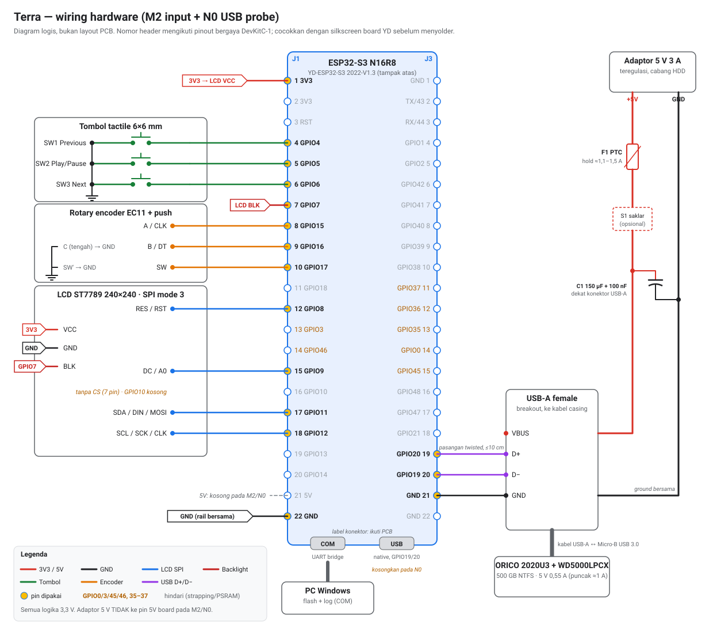

# Wiring hardware Terra — detail perakitan

Panduan ini menurunkan rencana di [hardware.md](hardware.md), [m2-n0-test.md](m2-n0-test.md),
dan [nas-proposal.md](nas-proposal.md) menjadi daftar kabel yang bisa dirakit.
Sumber kebenaran pin tetap `firmware/main/board_config.h`; jika berbeda, ikuti file itu.

**Status: belum ada wiring yang diuji secara fisik.** Nomor pin header diambil dari
pinout bergaya ESP32-S3-DevKitC-1 yang ditiru board YD-ESP32-S3. Cocokkan setiap
pin dengan silkscreen board Anda sebelum menyolder. Jalur VBUS HDD belum diterima.



Diagram dibuat ulang dengan `python scripts/gen-wiring-diagram.py docs/wiring-diagram.svg`.

## 1. Daftar komponen

| Kode | Komponen | Jumlah | Catatan |
| --- | --- | --- | --- |
| U1 | Board YD-ESP32-S3 N16R8 (`2022-V1.3`) | 1 | Flash 16 MB, PSRAM Octal 8 MB |
| LCD1 | Breakout ST7789 240×240 SPI, 7 pin tanpa CS | 1 | GND VCC SCL SDA RES DC BLK; skema belum diketahui |
| SW1–SW3 | Tactile switch 6×6 mm | 3 | Previous, Play/Pause, Next |
| ENC1 | Modul encoder bergaya KY-040 (terukur), atau EC11 | 1 | Half-step terukur (lihat §6) |
| J-USB | Breakout USB-A female 4 pin | 1 | Hanya untuk N0; menerima kabel casing |
| F1 | PTC resettable fuse | 1 | Hold ≥1,1 A, saran 1,5 A; part belum dipilih |
| C1 | Elektrolit low-ESR ≥150 µF / 10 V + keramik 100 nF | 1+1 | Di dekat J-USB, VBUS ke GND |
| S1 | USB power switch / load switch | 0–1 | Opsional; limit arus ≥1,2 A |
| PSU | Adaptor 5 V 3 A teregulasi | 1 | Hanya cabang HDD pada N0 |
| HDD | ORICO 2020U3 + WD5000LPCX 500 GB | 1 | 5 V 0,55 A, puncak ±1 A |
| — | Breadboard/protoboard, kabel jumper 24–28 AWG | — | Kabel daya HDD 22–24 AWG |

Kebutuhan kabel: 19 kabel untuk M2 (W6 tidak dipakai) dan 3 tambahan + 2 kabel daya untuk N0.

## 2. Mode daya

Satu mode aktif dalam satu waktu. Jangan pernah menyambung dua sumber 5 V
secara langsung.

| Mode | Dipakai untuk | Kabel PC | Adaptor 5 V | GPIO19/20 |
| --- | --- | --- | --- | --- |
| **A** | M1/M2, build `normal` | Konektor **USB native** (flash, log, daya board) | Tidak dipakai | Dipakai port USB native; breakout USB-A **dilepas** |
| **B** | N0, build `usb-probe` | Konektor **COM/UART** (flash, log, daya board) | Hanya ke VBUS HDD melalui F1/C1 | Ke breakout USB-A; port USB native **kosong** |
| **C** | NAS mandiri (tahap N1+) | Tidak ada | Bercabang ke board dan HDD | Ke breakout USB-A |

Mode C **belum diterima**: pin 5V board, dioda internal, dan regulator 3V3 YD belum
diukur. Pada mode A dan B pin 5V header dibiarkan kosong. Pada mode B, ground
adaptor tersambung ke ground board melalui J-USB; ini satu-satunya titik temu
kedua suplai, dan +5 V adaptor tidak pernah menyentuh board.

## 3. Pin board yang dipakai

Board dilihat dari atas, konektor USB di bawah. J1 kiri, J3 kanan, pin 1 di
ujung antena. Semua pin M2 berada di J1; hanya USB host di J3.

| Header | No | Pin | Fungsi Terra | Mode |
| --- | --- | --- | --- | --- |
| J1 | 1 | 3V3 | VCC LCD (dan `+` KY-040 bila dipakai) | A, B |
| J1 | 4 | GPIO4 | SW1 Previous | A, B |
| J1 | 5 | GPIO5 | SW2 Play/Pause | A, B |
| J1 | 6 | GPIO6 | SW3 Next | A, B |
| J1 | 7 | GPIO7 | LCD BLK (enable backlight) | A, B |
| J1 | 8 | GPIO15 | Encoder A / CLK | A, B |
| J1 | 9 | GPIO16 | Encoder B / DT | A, B |
| J1 | 10 | GPIO17 | Encoder push / SW | A, B |
| J1 | 12 | GPIO8 | LCD RES | A, B |
| J1 | 15 | GPIO9 | LCD DC | A, B |
| J1 | 16 | GPIO10 | **Kosong** — modul tanpa CS | — |
| J1 | 17 | GPIO11 | LCD SDA / MOSI | A, B |
| J1 | 18 | GPIO12 | LCD SCL / SCK | A, B |
| J1 | 21 | 5V | **Tidak disambung** | — |
| J1 | 22 | GND | Rail GND breadboard | A, B |
| J3 | 19 | GPIO20 | USB D+ ke breakout USB-A | B |
| J3 | 20 | GPIO19 | USB D− ke breakout USB-A | B |
| J3 | 21 | GND | GND breakout USB-A | B |

Jangan pakai GPIO35–37 (Octal PSRAM), GPIO0/3/45/46 (strapping), dan TX43/RX44
(console UART pada build `usb-probe`). GPIO48 biasanya LED RGB onboard; cek board.

## 4. Daftar kabel lengkap

Warna adalah saran agar mudah ditelusuri, bukan keharusan. GND adalah rail
breadboard yang disambung ke J1-22.

| Kabel | Dari | Ke | Warna | Mode |
| --- | --- | --- | --- | --- |
| W1 | J1-1 3V3 | LCD VCC | merah | A, B |
| W2 | J1-22 GND | rail GND | hitam | A, B |
| W3 | rail GND | LCD GND | hitam | A, B |
| W4 | J1-18 GPIO12 | LCD SCL/SCK/CLK | kuning | A, B |
| W5 | J1-17 GPIO11 | LCD SDA/DIN/MOSI | biru | A, B |
| ~~W6~~ | — | Tidak dipasang: modul 7 pin tanpa CS | — | — |
| W7 | J1-15 GPIO9 | LCD DC/A0 | hijau | A, B |
| W8 | J1-12 GPIO8 | LCD RES/RST | abu | A, B |
| W9 | J1-7 GPIO7 | LCD BLK/BL (lihat §5.2) | putih | A, B |
| W10 | J1-4 GPIO4 | SW1 kaki 1 | hijau | A, B |
| W11 | SW1 kaki diagonal | rail GND | hitam | A, B |
| W12 | J1-5 GPIO5 | SW2 kaki 1 | hijau | A, B |
| W13 | SW2 kaki diagonal | rail GND | hitam | A, B |
| W14 | J1-6 GPIO6 | SW3 kaki 1 | hijau | A, B |
| W15 | SW3 kaki diagonal | rail GND | hitam | A, B |
| W16 | J1-8 GPIO15 | ENC A / CLK | oranye | A, B |
| W17 | J1-9 GPIO16 | ENC B / DT | oranye | A, B |
| W18 | ENC C (pin tengah) | rail GND | hitam | A, B |
| W19 | J1-10 GPIO17 | ENC SW (kaki 1) | oranye | A, B |
| W20 | ENC SW (kaki 2) | rail GND | hitam | A, B |
| W21 | J3-19 GPIO20 | USB-A pin 3 D+ | hijau | B |
| W22 | J3-20 GPIO19 | USB-A pin 2 D− | putih | B |
| W23 | J3-21 GND | USB-A pin 4 GND | hitam | B |
| W24 | PSU +5 V → F1 → (S1) | USB-A pin 1 VBUS; C1 di sini | merah 22–24 AWG | B |
| W25 | PSU GND | USB-A pin 4 GND | hitam 22–24 AWG | B |
| — | PC | konektor USB native (mode A) / COM (mode B) | kabel USB-C data | A / B |

## 5. LCD ST7789 240×240

### 5.1 Sinyal

| Pin LCD (nama umum) | ESP32-S3 | Keterangan |
| --- | --- | --- |
| GND | GND | Ground bersama |
| VCC | 3V3 (J1-1) | Pastikan breakout mendukung 3,3 V |
| SCL / SCK / CLK | GPIO12 | SPI clock, bukan I²C walau berlabel SCL |
| SDA / DIN / MOSI | GPIO11 | Data ke LCD; tidak ada MISO |
| RES / RST | GPIO8 | Reset, dikendalikan firmware |
| DC / A0 / RS | GPIO9 | Data/command |
| CS | — | Tidak ada; terikat ke GND di modul (lihat bawah) |
| BLK / BL / LED | GPIO7 | Enable backlight, active high; lihat §5.2 |

Panjang kabel SPI usahakan ≤15 cm. Firmware memakai 20 MHz; bila gambar rusak,
turunkan `BOARD_LCD_SPI_HZ` sebelum mencurigai controller.

**Modul pengguna: 7 pin tanpa CS** (GND, VCC, SCL, SDA, RES, DC, BLK; dikonfirmasi
11 Oktober 2026). CS chip ST7789 terikat ke GND di PCB modul, jadi LCD selalu
terpilih. Karena itu `board_config.h` memakai `BOARD_LCD_CS = GPIO_NUM_NC` (GPIO10
kosong, kabel W6 tidak dipasang) dan `BOARD_LCD_SPI_MODE = 3`. Tanpa tepi turun CS,
LCD tidak punya penanda awal byte; modul jenis ini umumnya hanya terbaca benar
dengan clock idle HIGH (mode 3). Belum diuji pada modul fisik.

Gejala mode SPI salah: backlight menyala tetapi layar hitam, sementara log tetap
`ST7789 initialized` karena ESP32 tidak membaca balik dari LCD (tanpa MISO).
Urutan penanganan: cek W4/W5/W7/W8, turunkan `BOARD_LCD_SPI_HZ` ke 10 MHz, lalu
baru coba `BOARD_LCD_SPI_MODE` = `0`.

### 5.2 Backlight

GPIO7 adalah sinyal enable, bukan sumber arus LED. Ukur dulu:

1. Sambungkan GND dan VCC LCD saja (3V3), BLK belum disambung.
2. Pasang multimeter mode mA antara 3V3 dan BLK.
3. Arus ≤2 mA: BLK adalah input transistor/pull-up modul → W9 langsung ke GPIO7.
4. Arus jauh lebih besar (umumnya >10 mA): BLK langsung ke LED → pakai driver.

Driver high-side sederhana: PNP S8550/2N3906, emitter ke 3V3, collector ke BLK,
basis melalui resistor 1 kΩ ke GPIO7. Rangkaian ini active-low, jadi ubah
`BOARD_LCD_BL_ON_LEVEL` menjadi `0`. Jika BLK dibiarkan kosong dan backlight
tetap menyala, modul memiliki pull-up; GPIO7 tetap boleh disambung.

## 6. Tombol dan encoder

Semua input active-low: firmware mengaktifkan pull-up internal pada GPIO4/5/6/15/16/17
dan debounce 40 ms. Tidak perlu resistor atau kapasitor eksternal untuk M2.

**Tactile 6×6 mm 4 kaki.** Dua kaki pada sisi panjang yang sama sudah tersambung
di dalam. Pakai dua kaki **diagonal** agar pasti melewati kontak sakelar: satu
kaki ke GPIO, kaki diagonalnya ke GND.

**EC11 tanpa modul (5 kaki).** Sisi tiga kaki: A – C – B, C di tengah. Sisi dua
kaki: sakelar push.

| Kaki EC11 | Sambungan |
| --- | --- |
| A | GPIO15 |
| C (tengah) | GND |
| B | GPIO16 |
| SW kaki 1 | GPIO17 |
| SW kaki 2 | GND |

**Modul KY-040.** CLK → GPIO15, DT → GPIO16, SW → GPIO17, `+` → **3V3** (bukan 5 V),
GND → GND. Pull-up 10 kΩ pada modul ke `+` aman bersama pull-up internal.

Encoder pengguna terukur half-step: dua transisi per klik, detent di AB=11 dan
AB=00, sehingga `BOARD_ENCODER_HALF_STEP` = `true`. Untuk EC11 full-step (empat
transisi per klik), set `false`.
Bila arah terbalik, tukar W16/W17 atau balik `BOARD_ENCODER_DIRECTION`.

## 7. USB host dan daya HDD (N0)

Sambungkan bagian ini **hanya** untuk build `usb-probe` dan setelah §8 tahap 3 lulus.

### 7.1 Data

| Pin USB-A female | Sinyal | Sambungan |
| --- | --- | --- |
| 1 | VBUS | +5 V dari PSU melalui F1 (dan S1 bila ada) |
| 2 | D− | GPIO19 (J3-20) |
| 3 | D+ | GPIO20 (J3-19) |
| 4 | GND | GND board (J3-21) **dan** GND PSU |

- D+ dan D− dipilin (twisted pair), panjang sama, ≤10 cm. USB Full Speed
  12 Mbit/s toleran pada jarak ini, tetapi tidak toleran kabel jumper panjang.
- PHY internal ESP32-S3 menyediakan pull-down host; jangan tambah resistor.
- GPIO19/20 tersambung juga ke konektor USB native. Konektor itu harus **kosong**
  selama breakout USB-A terpasang. Sebaliknya, lepas W21/W22 saat kembali ke mode A.
- Jangan menyolder pad `USB-OTG` atau `IN-OUT` berdasarkan foto. VBUS host tidak
  diambil dari board.

### 7.2 Daya

```text
PSU +5V ── F1 PTC ── [S1 opsional] ──┬── USB-A VBUS ── kabel ── casing ORICO
                                     ├── C1 150 µF (+) / 100 nF
PSU GND ─────────────────────────────┴── USB-A GND ──┬── kabel ── casing ORICO
                                                     └── J3-21 GND board (referensi)
```

- Arus balik HDD mengalir PSU ↔ J-USB lewat W25, bukan lewat board. W23 hanya
  referensi sinyal, jadi cukup kabel sinyal.
- C1 diperlukan menahan lonjakan spin-up; perhatikan polaritas elektrolit.
- F1: hold ≥1,1 A agar tidak trip saat spin-up 1 A; saran 1,5 A.
- Adaptor pasif USB-A ke USB-C dan kabel Y tidak menyediakan suplai tambahan dan
  tidak boleh dipakai sebagai pengganti cabang ini.

**Kesalahan yang ditemukan saat uji pertama (11 Oktober 2026):**

- Kabel GPIO dan GND tombol pada dua kaki yang tersambung di dalam: pin selalu LOW,
  tidak ada event. Pakai kaki diagonal.
- Kaki GND tombol tidak sampai ke GND (misalnya rail breadboard terputus di tengah):
  saat disentuh muncul pulsa LOW pendek tiap ±20 ms (dengung 50 Hz), bukan LOW stabil.
- Encoder di GPIO8/9/10 menimpa RES/DC LCD: backlight menyala, layar hitam.

**Pemindai pin.** Set `BOARD_DIAG_PIN_SCAN` = `1` di `board_config.h`, build dan
flash. Firmware tidak menjalankan aplikasi; semua pin hanya dibaca. Log menampilkan
setiap GPIO header sebagai `open`, `TIED LOW (GND)` atau `TIED HIGH`, lalu mencatat
setiap perubahan level saat kontrol ditekan atau diputar. Kembalikan ke `0` setelahnya.

## 8. Urutan perakitan dan uji

Kerjakan bertahap. Cabut semua daya setiap kali memindahkan kabel.

**Sebelum daya pertama, dengan multimeter:**

- 3V3–GND dan 5V–GND board tidak short (nilai Ω naik perlahan karena kapasitor wajar).
- Setiap kabel W1–W20 (kecuali W6): kontinuitas dari pin header ke kaki komponen yang benar,
  dan tidak tersambung ke pin tetangga.
- Untuk mode B: VBUS–GND J-USB tidak short; polaritas C1 benar.

**Tahap 1 — LCD (M1).** Pasang W1–W5 dan W7–W9. Mode A, build `normal`. Ukur 3V3 = 3,2–3,4 V.
Harapan log: `ST7789 initialized (240x240, gap 0/0)` lalu `Mock screen ready`.
Catat orientasi, warna, dan tepi terpotong (kalibrasi di hardware.md).

**Tahap 2 — input (M2).** Tambah W10–W20. Jalankan tabel uji di m2-n0-test.md:
setiap tombol satu event, encoder ±2 per detent, push = MUTE.

**Tahap 3 — daya HDD tanpa data.** Board tidak terhubung. Rakit W24/W25, F1, C1,
J-USB, pasang casing. Nyalakan PSU: HDD harus spin-up. Ukur VBUS di J-USB saat
spin-up; target ≥4,75 V. Jika turun di bawahnya, perpendek/pertebal kabel atau
ganti adaptor. Jangan lanjut sebelum tahap ini stabil.

**Tahap 4 — data (N0).** PSU mati. Flash build `usb-probe` lewat COM, port USB native
kosong. Tambah W21–W23. Nyalakan board (PC/COM) dahulu, lalu PSU. Ikuti log yang
diharapkan di m2-n0-test.md. Ukur ulang VBUS dan catat apakah ESP32 reset.

## 9. Anggaran arus (estimasi)

| Beban | Arus | Sumber |
| --- | --- | --- |
| ESP32-S3 (Wi-Fi TX, puncak) | hingga ±0,35 A | Datasheet ESP32-S3; M2/N0 belum memakai Wi-Fi |
| LCD termasuk backlight | ±20–60 mA | Estimasi, bergantung modul |
| Input | <1 mA | Pull-up |
| HDD + bridge casing | 0,55 A nominal, ±1 A puncak | Label dan datasheet WD |

Mode A/B: board ditanggung port PC (≤0,5 A untuk USB 2.0), HDD ditanggung PSU.
Total mode C sekitar 1,5 A puncak; adaptor 3 A adalah margin desain, bukan hasil ukur.
Kapasitas regulator 3V3 board YD belum diverifikasi; jangan beri beban 3V3 lain.

## 10. Larangan

- Jangan sambungkan PSU +5 V ke pin 5V board pada mode A/B.
- Jangan hubungkan HDD ke konektor USB native dengan anggapan board memasok VBUS.
- Jangan pakai 5 V untuk VCC LCD atau `+` KY-040; semua GPIO hanya 3,3 V.
- Jangan pasang breakout USB-A dan kabel PC di port USB native bersamaan.
- Jangan ubah eFuse, pad solder, atau format HDD sebagai bagian dari wiring ini.

## 11. Yang dilaporkan setelah merakit

Foto wiring dari atas, model LCD/encoder aktual, hasil ukur arus BLK (§5.2),
tegangan 3V3, tegangan VBUS saat spin-up, apakah modul LCD punya CS, dan log
dari reset sampai `Mock screen ready` (M1/M2) atau hasil probe (N0).
